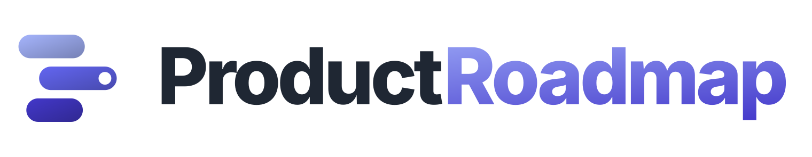
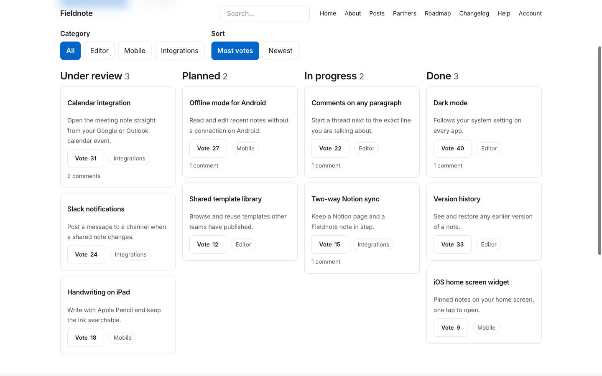
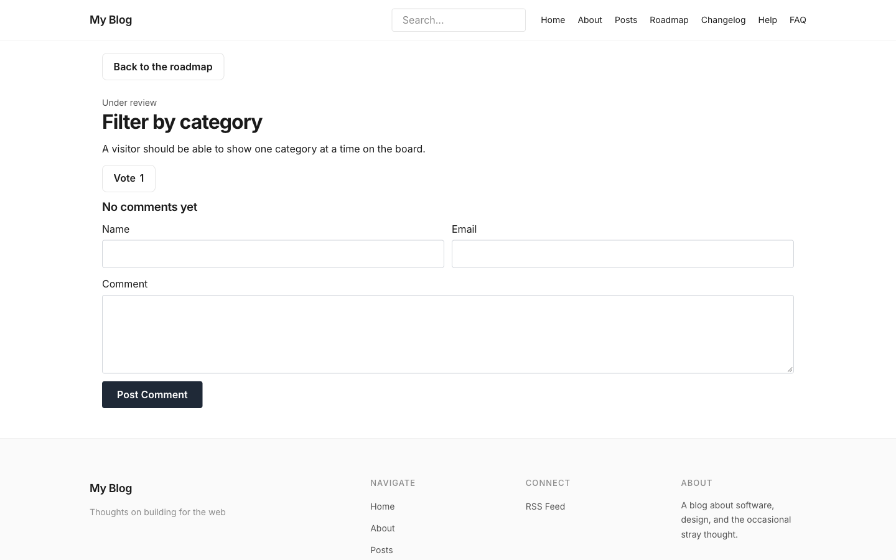
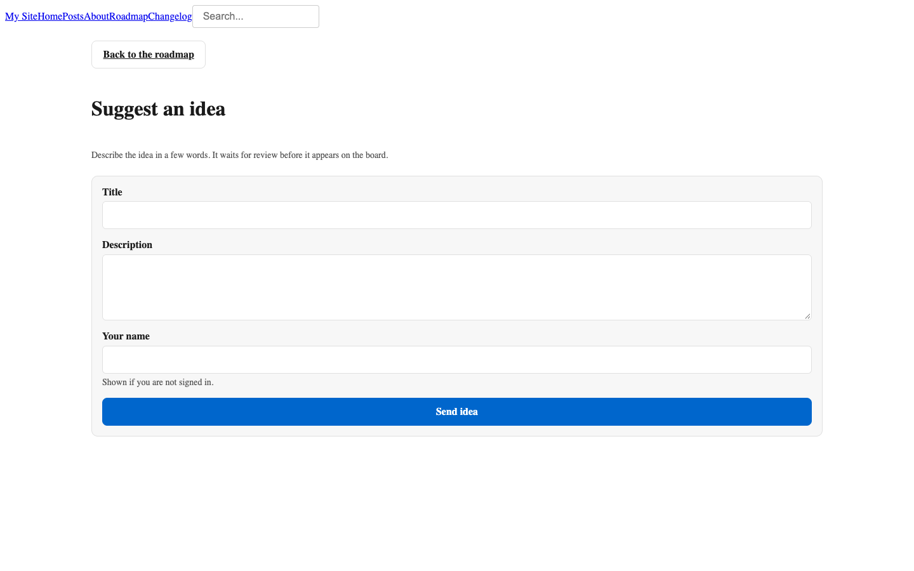
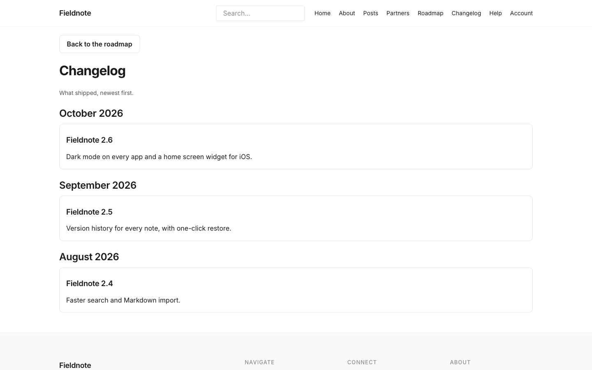
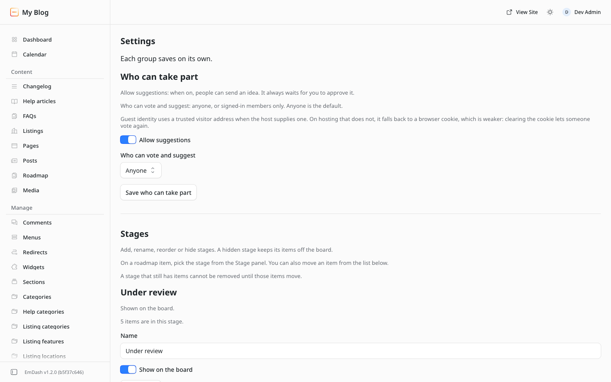

<h3 align="center">A public roadmap where your visitors vote</h3>

Show what you are considering, building and have shipped. People vote on what matters to them and suggest ideas of their own, and you decide what reaches the board.

  <a href="https://plugins.emdashcms.com/plugins/@vapvarun.bsky.social/roadmap"><b>Install from the EmDash registry</b></a>
  &nbsp;·&nbsp;
  <a href="docs/website/getting-started/introduction.md">Read the docs</a>
  &nbsp;·&nbsp;
  <a href="https://github.com/wbcomdesigns/emdash-roadmap/releases">What's new</a>

## Who it is for

A product team showing customers what is coming, a blogger asking readers what to write next, or a studio letting clients say which services they want. If you want people to tell you what matters, without a separate feedback service, Product Roadmap is for you.

## What you get

**For you, the site owner**

- **A board with stages you name.** It starts with Under review, Planned, In progress and Done. Add, hide, rename or reorder them.
- **Suggestions you approve.** An idea is saved as a draft. You approve it onto the board or reject it.
- **You choose who takes part.** Anyone, or only signed-in members. Guests add a name, and written ideas always wait for review.
- **A changelog** with a list page and a page for each release.
- **Merge duplicates.** Fold a copy into the item you keep. Votes move across, one per person.
- **A dashboard card** that shows how many ideas are waiting, and one short email an hour when ideas are waiting, if your site can send mail.

**For your visitors**

- **One vote per item**, and a second click takes it back.
- **Suggest an idea** from the board.
- **Comments** on each item, using EmDash's own comments.
- **Filter and sort** the board by category, Most votes or Newest.

  
  

## Looks like your site

The board, item pages and changelog take their colours from your EmDash theme and follow light and dark. Change any wording, or the page files themselves. See [Wording and look](docs/website/customize/wording-and-look.md).

  
  

## Get started

1. In your EmDash dashboard, open **Plugins**, then **Registry**, search for **Product Roadmap** and install it. It needs EmDash 1.2 or later and a site that can run registry plugins.
2. Copy the visitor pages into your site once, as the [install guide](docs/website/getting-started/install.md) shows.
3. Add the Roadmap and Changelog links to your menu, then open **Roadmap**, **Ideas** in your dashboard.

## Good to know

- **The visitor pages are a small kit you copy in.** An EmDash plugin cannot add pages to a site by itself. Until you copy the kit, `/roadmap/` shows your site's 404 page. Copy it again after every update.
- **Guests can vote when your host passes on the visitor's address.** That works on Cloudflare, or with `trustedProxyHeaders` in your site config. Otherwise guests see a sign-in link.
- **Every suggested idea waits for you.** Nothing a visitor writes reaches the board until you approve it.
- **Free, with no paid version.**

## Docs

- [Introduction](docs/website/getting-started/introduction.md)
- [Install](docs/website/getting-started/install.md)
- [First steps](docs/website/getting-started/first-steps.md)
- [Use cases](docs/website/getting-started/use-cases.md)
- [Settings reference](docs/website/settings/settings-reference.md)
- [Wording and look](docs/website/customize/wording-and-look.md)
- [FAQ](docs/website/faq/faq.md) and [Troubleshooting](docs/website/troubleshooting/troubleshooting.md)

## More from Wbcom Designs for EmDash

[Learnomy](https://github.com/wbcomdesigns/emdash-learnomy) courses · [Listora](https://github.com/wbcomdesigns/emdash-listora) directories · [WB Reviews](https://github.com/wbcomdesigns/emdash-reviews) · [WB Polls](https://github.com/wbcomdesigns/emdash-polls) · [KnowX](https://github.com/wbcomdesigns/emdash-knowx)

Found a bug or have an idea? [Open an issue](https://github.com/wbcomdesigns/emdash-roadmap/issues). Want to build on Product Roadmap? Start with [CONTRIBUTING.md](CONTRIBUTING.md).

MIT licence. Made by [Wbcom Designs](https://wbcomdesigns.com).
