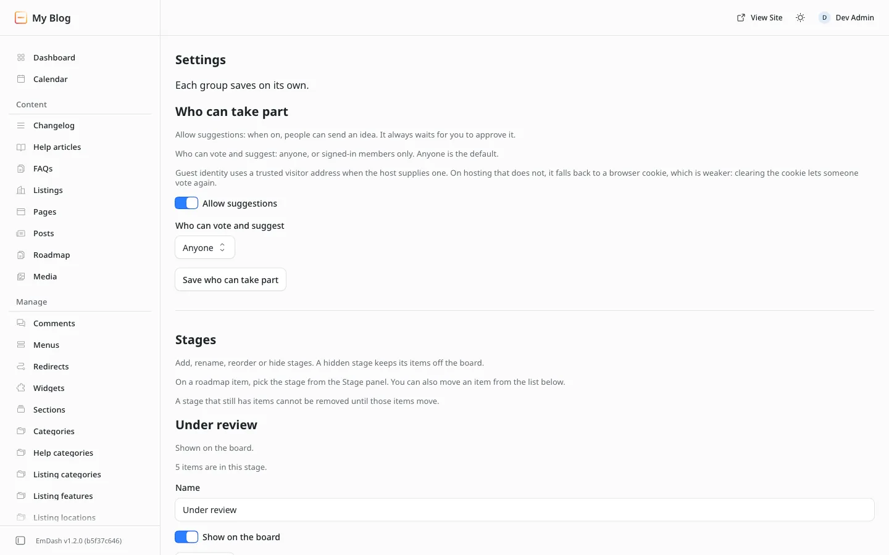

# Settings reference

**Included in Free.** Product Roadmap has no paid version.

Every setting is on one screen: **Roadmap**, then **Settings**. Each group has its own save button and saves on its own.

## Who can take part

Saved with **Save who can take part**. You see "Who can take part was saved."

| Setting | What it controls | Default |
| --- | --- | --- |
| Allow suggestions | When on, people can send an idea. It always waits for your approval. When off, the Suggest an idea button leaves the board and the suggest page says suggestions are closed | On |
| Who can vote and suggest | **Anyone**, or **Signed-in members only**. Guests who try under members only are asked to sign in | Anyone |

The screen also explains guest identity. With a visitor address from your hosting, a guest is counted by it. Without one, it falls back to a browser code, which is weaker: clearing it lets someone vote again. See [Voting](../using/voting.md#how-a-guest-vote-is-counted).

## Stages

Each stage has its own **Save stage** button.

| Setting | What it controls | Default |
| --- | --- | --- |
| Name | The column heading. Up to 40 characters, no duplicates | Under review, Planned, In progress, Done |
| Show on the board | Off hides the column and keeps its items off the board | On |
| Move up / Move down | The order of the columns, left to right | In the order above |
| Remove | Deletes a stage. Refused while items are in it, and you must keep at least one | - |
| New stage name | The name for **Add stage**. The board holds up to 20 stages | Empty |
| Show on the board (new stage) | Whether the new stage starts shown | On |
| Move an item, To this stage | Moves one item to another stage without opening it | Empty |

The block also tells you how many items are in each stage. See [Items and stages](../using/items-and-stages.md).

## Email

Saved with **Save email**. You see "Email settings were saved."

| Setting | What it controls | Default |
| --- | --- | --- |
| Email me when ideas are waiting | One short notice an hour while ideas are waiting. It has no idea text and no link | On |
| Send that email to | The address that gets the notice | Empty |

Things to know:

- The email goes out only when the switch is on, the address is filled in, there are ideas waiting, and the site has a mail provider. The official Resend plugin is the usual setup.
- With the address empty, no email is sent even though the switch is on. The screen says so.
- An address that is not valid is refused: "Enter a real email address, or leave it empty. Nothing was changed."
- The dashboard card works with or without mail.

## Not on this screen

These are set elsewhere:

| What | Where |
| --- | --- |
| Item titles, descriptions and publish state | The **Roadmap** content type |
| An item's stage | The **Stage** panel in the item editor |
| Categories | The **Roadmap categories** list in admin |
| Comments on or off | The Roadmap content type's comment setting |
| Release notes | The **Changelog** content type |
| Every phrase visitors read | The wording file. See [Wording and look](../customize/wording-and-look.md) |
