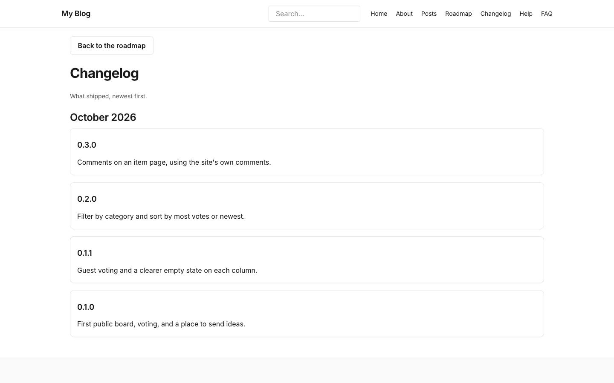

# The changelog

**Included in Free.** Product Roadmap has no paid version.

The changelog tells visitors what shipped. It has a list page at `/changelog/` and a page for each release at `/changelog/<slug>/`.

## Add a release

1. In admin, open the **Changelog** content type and add an entry.
2. Fill in:

| Field | What it is for |
| --- | --- |
| Title | The release name, for example a version number or a short headline |
| Summary | A few lines about what shipped. Shown in the list and on the release page |
| Released | The date. It decides the order and the month heading |

3. Publish it.

## What visitors see

- **List page:** releases newest first, grouped under a heading for each month. Each release shows its title as a link, with the summary under it. If none are published, it says "No releases yet."
- **Release page:** the title and the summary, with a link back to the changelog.
- A **Changelog** button on the board leads to the list. Add `/changelog/` to your menu too.

The month follows your site's time zone. An entry with no **Released** date is filed under a heading named Changelog, so always fill the date in.

## Good to know

- The changelog is a normal EmDash content type. It has no votes and no comments.
- The list shows the 100 newest releases.
- The release page shows the title and summary only. Put the full notes in the summary, or link out to a longer post.
- Changelog entries do not link to roadmap items. When an item ships, move it to your last stage and add a release.

## Next step

[Who can do what](who-can-do-what.md).
