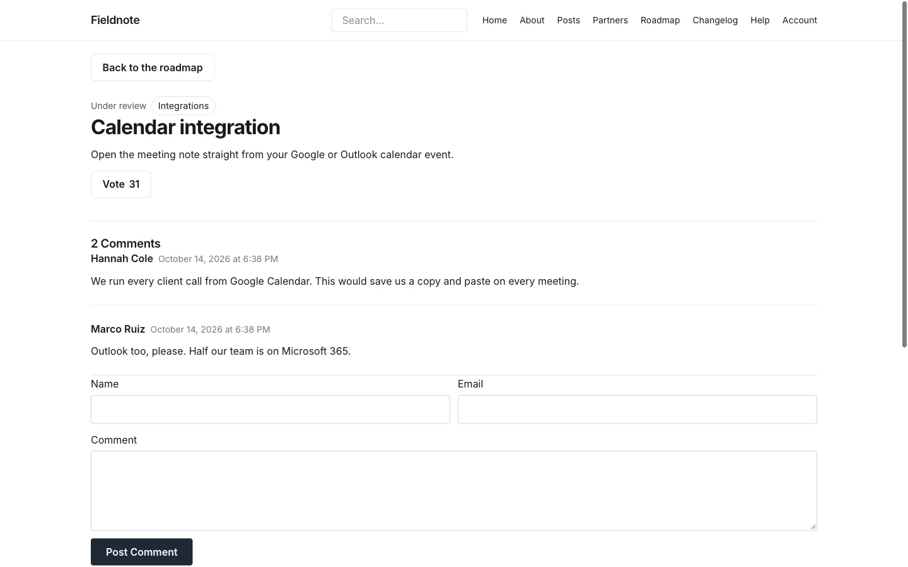

# Items and stages

**Included in Free.** Product Roadmap has no paid version.

An item is one entry in the **Roadmap** content type. Its stage decides which column it sits in.

## Add or edit an item

1. In admin, open the **Roadmap** content type and add an entry.
2. Fill in **Title** and **Description**. The description is plain text. Line breaks are kept.
3. Pick a category, if you use them.
4. Set the stage with the **Stage** panel (see below).
5. Publish it.

Each item has its own page at `/roadmap/<slug>/`. It shows the stage and category, the title, the description, a **Vote** button and the comments. A link takes visitors back to the roadmap.

## Set an item's stage

The **Stage** panel in the editor sidebar is the place to set it. It shows **Stage now** and one **Move to** button for each other stage you named; a stage you hid shows with "(hidden)" after its name. Choose a button. The panel is the one place to set the stage. An editor page that was opened before the move cannot undo it. Saving a stage the item left through the panel is refused with a message that says to set the Stage box to the new stage or reload. A different stage you type in the Stage box and save is kept. Visitors see a move on the board within about two minutes, because the board is cached briefly.

If the item has unpublished changes (the editor saves them as you type), the move goes into those changes. The panel then shows the stage in the unpublished changes and the stage on the board now, and the board changes when you publish. Discard the changes and the item keeps its published stage; restoring an older revision keeps that revision's stage.

To move an item without opening it, use **Settings**, **Stages**, **Move an item**. It does the same as the panel.

If an item has unpublished edits, both places refuse with a message. Publish or discard the edits first, then move it.

### Stage names must match

The item stores the stage as text. If it holds a name that is not on your list, the item shows in the first column. This can happen if someone types in the entry's own **Stage** box. Use the **Stage** panel instead. On a new site that box is labelled "Stage (set it in the Stage panel)".

Renaming a stage is safe. Items keep working, and you do not edit them one by one.

## Manage stages

Open **Roadmap**, then **Settings**, then the **Stages** tab. Each stage has its own form.

| Do this | How |
| --- | --- |
| Rename | Change **Name** and choose **Save stage** |
| Hide from the board | Turn off **Show on the board** and choose **Save stage** |
| Reorder | Choose **Move up** or **Move down** |
| Add | Fill in **New stage name**, set **Show on the board**, and choose **Add a stage** |
| Remove | Choose **Remove** and confirm |

The rules:

- A stage name can be up to 40 characters, and no two stages can share a name.
- The board can have up to 20 stages.
- You must keep at least one stage.
- A stage that still has items cannot be removed. Move them first. Drafts count too.
- The first stage in your list is where new and approved ideas land. Keep it shown on the board, or approved ideas will seem to vanish.

## Comments

If comments are on for the Roadmap content type, each item page shows EmDash's own comment list and form. You moderate them in EmDash's comment screens. If comments are off, the page says "Comments are closed on this site."

## Next step

[Voting](voting.md).
