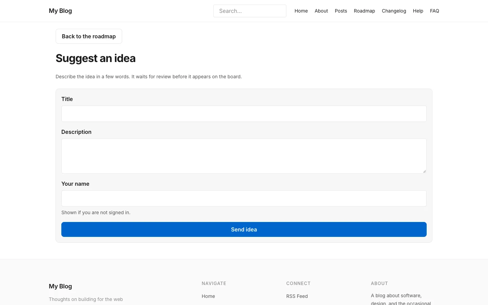
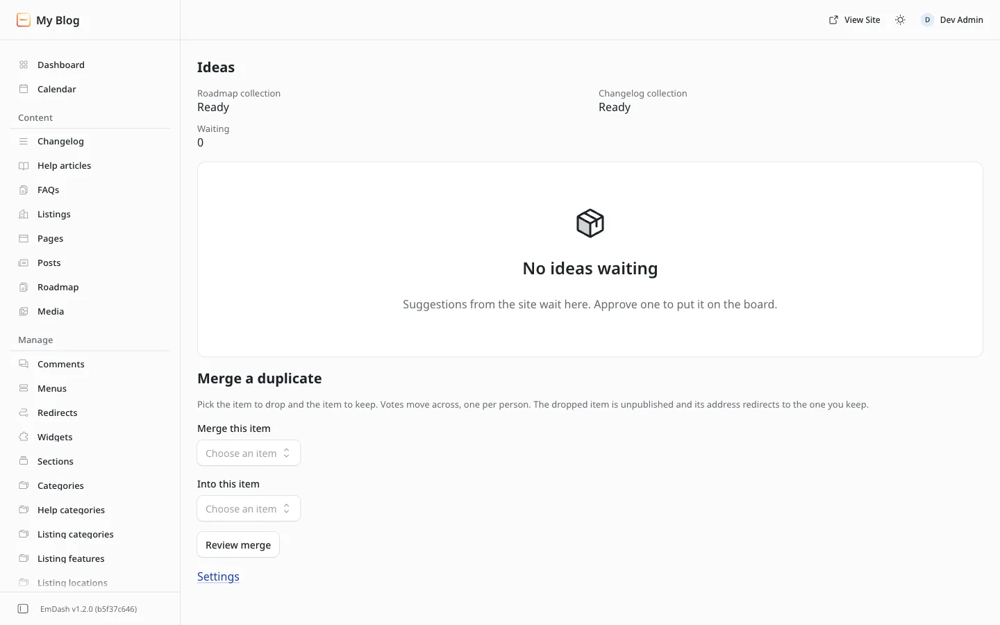

# Suggestions and the Ideas queue

**Included in Free.** Product Roadmap has no paid version.

Visitors can send ideas. Every idea waits for you in the **Ideas** queue until you approve or reject it. Nothing a visitor writes goes live on its own.

## What a visitor does

1. On the board, choose **Suggest an idea**. The page is `/roadmap/suggest/`.
2. Fill in the form:

| Field | Limit | Notes |
| --- | --- | --- |
| Title | 120 characters | Required |
| Description | 4000 characters | Optional |
| Your name | 60 characters | Required for guests. Signed-in members use their account name |

3. Choose **Send idea**. They see "Thanks. Your idea is waiting for review."

Each person can send up to 8 ideas an hour. After that they see "Too many requests. Try again in an hour." The form also has a hidden field that catches simple spam bots.

## Turn suggestions off

In **Settings**, turn off **Allow suggestions**. The **Suggest an idea** button leaves the board, and the suggest page shows only "Suggestions are closed right now."

## Who can suggest

| Setting | Guests | Signed-in members |
| --- | --- | --- |
| Anyone (default) | Can suggest, with a name | Can suggest |
| Signed-in members only | See "Sign in to continue." with a **Sign in** link | Can suggest |

## Decide on ideas

In admin, open **Roadmap**, then **Ideas**.

1. The top shows **Roadmap collection** and **Changelog collection** (**Ready** or **Missing**) and **Waiting**, the number of ideas waiting.
2. The table lists each waiting idea with its **Title**, **Description** in full, and **From**. A guest shows as their name followed by "(guest)". A member shows by name.
3. In the **Decision** column, choose **Decide**, then **Approve** or **Reject**.

| Decision | What happens |
| --- | --- |
| Approve | The idea is published in your first stage, **Under review** by default, and appears on the board. You see "Idea published to the board." |
| Reject | The idea is not published. You see "Idea rejected. It stays a draft." The draft stays in the Roadmap content type, where you can delete it |

Things to know:

- To tidy an idea before it goes live, open its draft in the content screens, fix the title or description, and publish it there. You see exactly what goes on the board, and the idea leaves the Ideas list by itself. **Approve** only publishes drafts nobody has edited; on an edited draft it tells you to publish from the editor instead.
- The queue shows the 50 newest waiting ideas.
- If another admin decided the same idea first, you see "That idea is no longer waiting." and the table refreshes.
- To fold an idea into an item you already have, use [Merge a duplicate](merge-duplicates.md) instead.

## Get told when ideas are waiting

Two things tell you, so you do not have to check:

- **Dashboard card.** The EmDash dashboard has a **Roadmap: waiting for you** card. It shows **Ideas waiting** with a count, or "Nothing is waiting.", and an **Open ideas** link.
- **Email.** At most one short email an hour while ideas are waiting. It has no idea text and no link. It needs a mail provider and an address in **Send that email to**. See the [Settings reference](../settings/settings-reference.md#email).

## Next step

[Merge a duplicate](merge-duplicates.md).
