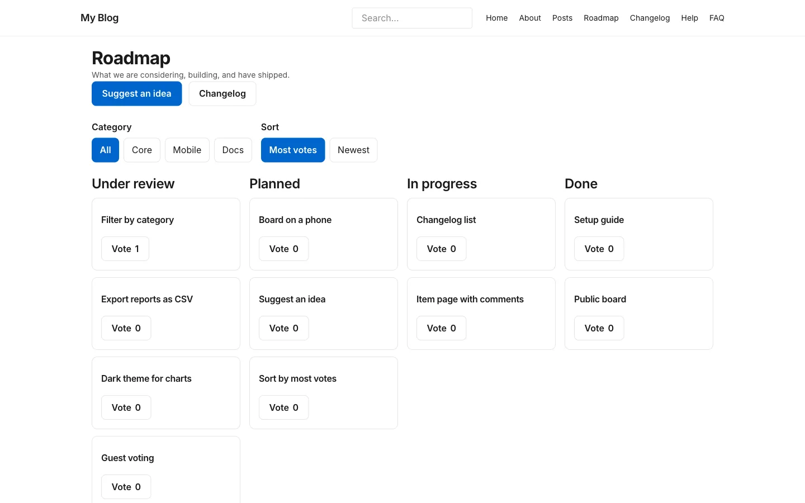
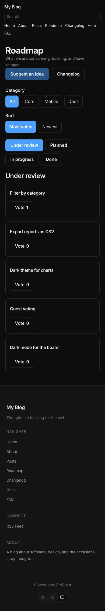

# The board

**Included in Free.** Product Roadmap has no paid version.

The board is the page at `/roadmap/`. It shows every published roadmap item as a card, in one column per stage.

## What visitors see

- A heading, a short intro, and a **Suggest an idea** button and a **Changelog** button at the top.
- A **Category** filter and a **Sort** filter.
- One column per stage that is shown on the board. Each card has the item's title and a **Vote** button with its count.
- An empty column says "Nothing in this stage yet."

The board loads its cards after the page opens, so it needs JavaScript. Without it, visitors see "The roadmap needs JavaScript to show items."

## Filter and sort

**Category** lists **All** plus every category you created. Choosing one shows only the items in that category.

**Sort** has two choices:

| Choice | What it does |
| --- | --- |
| Most votes | Cards with the most votes come first. Ties show the newest first. This is the default |
| Newest | The most recently published cards come first |

The choice lives in the address, for example `/roadmap/?sort=newest`, so visitors can share a filtered view.

## On a phone

On a screen 640 pixels wide or less, the board shows one stage at a time. A row of tabs, one per stage, switches between them. On a tablet the columns sit two across. On a desktop they sit four across, and more stages wrap onto the next row.

## What the board shows and hides

- Only **published** items appear. Drafts and rejected ideas stay off.
- A stage you hide in **Settings** is not a column. Its items are off the board. Their own pages still open if someone has the address.
- An item whose stage is not on your list appears in no column. See [Items and stages](items-and-stages.md#stage-names-must-match).
- The board shows up to 100 items. Past that, some items are left out, so retire old ones as the board grows.

## How fresh it is

Your site keeps the board for a short time to stay fast. A change you make can take a couple of minutes to reach visitors. Visitors who have voted always see their own vote straight away.

## Next step

[Items and stages](items-and-stages.md).
